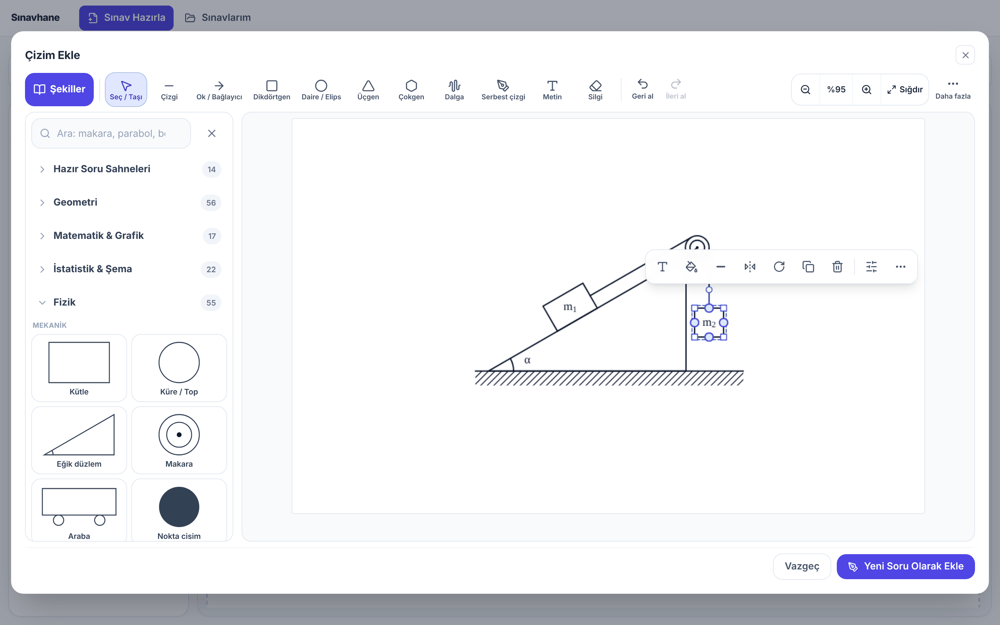
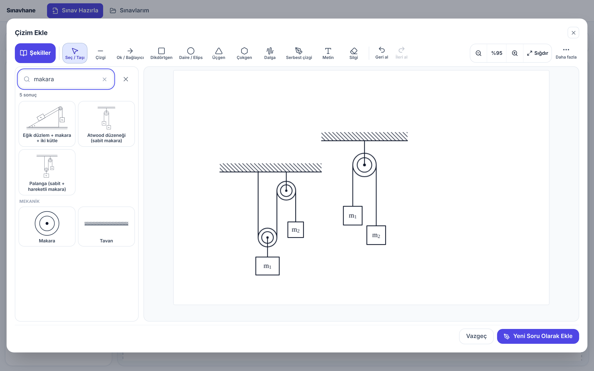
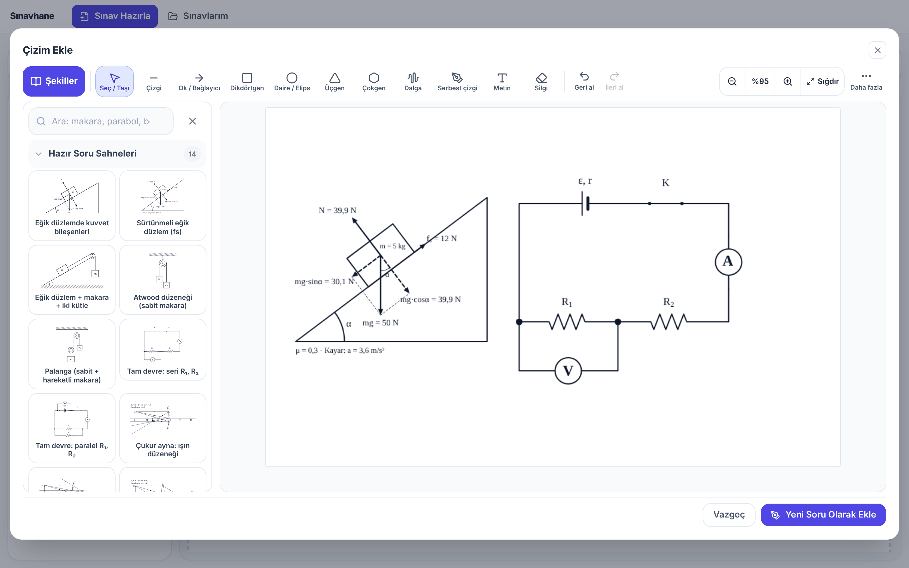
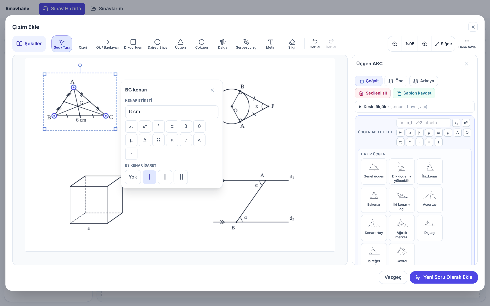
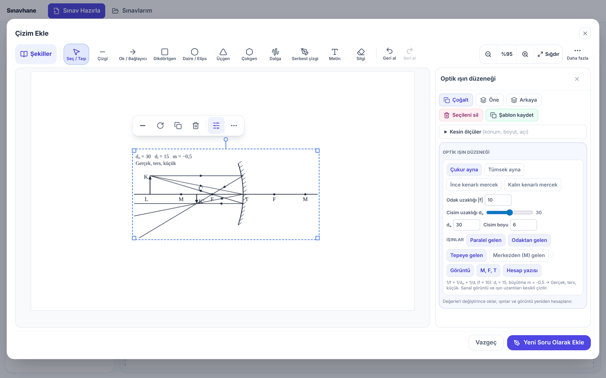

# Sınavhane Fizik

Fizik öğretmenleri için **ücretsiz ve açık kaynaklı** yazılı sınav hazırlama uygulaması. A4 yazılı kâğıdı hazırlayın; fizik sorularının şekillerini (düzenekler, devreler, optik, vektörler, hareket grafikleri…) birkaç tıkla çizin. Çıktılar siyah-beyaz baskıya uygundur. Arayüz Türkçedir, internet gerekmez, verileriniz yalnız kendi bilgisayarınızda kalır.

> **Bu sürüm yalnız fizik içindir.** Kimya, akış şeması, ileri istatistik/şema (Venn, olasılık ağacı…), ileri matematik ve coğrafya şekilleri kütüphaneden **gizlenmiştir** (kodu silinmedi; `src/modules/sinav-olusturucu/odak.ts` içindeki tek anahtarla geri açılır). Bu şekilleri içeren eski sınavlarınız yine açılır, görüntülenir, yazdırılır ve düzenlenir.



## Neler çizebilirsiniz?

| Alan | Örnekler |
|---|---|
| **Hazır fizik sahneleri** | Tek tıkla gelen, parça parça düzenlenebilen düzenekler: eğik düzlemde kuvvet bileşenleri (mg·sinα, mg·cosα, N, sürtünme; kütle değişince oklar kendiliğinden uzar), eğik düzlem + makara + iki kütle, Atwood, palanga, seri/paralel tam devre (ε, r, anahtar, ampermetre, voltmetre), çukur/tümsek ayna ve ince/kalın kenarlı mercek ışın düzenekleri (görüntü 1/f = 1/dₒ + 1/dᵢ ile hesaplanır), bölmeli sıvı kabı, kaldırma kuvveti, U borusu, manyetik kuvvet panelleri, boş eksenli grafik panelleri |
| **Fizik** | Kütle, makara, yay, araba, eğik düzlem, devre elemanları, manyetizma (düz tel, halka, solenoid, ⊗ ⊙ alan, mıknatıs alan çizgileri, indüksiyon/Lenz), mercek, ayna, prizma, girişim deseni, enerji düzeyleri, vektörler ve kareli alan; konum–zaman, hız–zaman, ivme–zaman grafikleri ve üçlü grafik; **ayarlanabilir fizik şekilleri:** akışkanlar (Torricelli, Bernoulli, hidrolik pres, manometre), dalgalar (atma, dalga, rezonans, Doppler, kırınım), elektrik–manyetizma (alan, Coulomb, levhalar, parçacık, iletken çubuk, transformatör), çembersel hareket, yörünge/Kepler, basit harmonik hareket, dönme, hareket kavramları (yol–yer değiştirme, bağıl hareket, serbest düşme, stroboskop, v–t/x–t), fotoelektrik olay, radyoaktif bozunma ve basit makineler (kaldıraç, makara, eğik düzlem); değerler yan panelden değişir, köklü (√) giriş desteklenir |
| **Geometri (temel)** | Adlı üçgenler (genel, dik, 30-60-90, ikizkenar, eşkenar), ağırlık merkezi; çember (kiriş, merkez açı, teğet, daire dilimi); düzgün çokgenler; paralelkenar, kare/dikdörtgen + köşegen; açı yayı, dik açı ve eş kenar işaretleri |
| **Grafik y = f(x)** | Doğru, parabol, mutlak değer, üstel/log, trigonometri, parçalı fonksiyon, hiperbol + asimptot, eğri altı ve iki eğri arası alan, teğet, koordinat düzlemi, serpme + regresyon doğrusu; **yazarak çiz** (`y = x^2 - 4`, `0,5; 5,15; 9,15`) |
| **Tablo ve sütun grafik** | Deney verileri için sütun, gruplu sütun, çubuk ve çizgi grafiği; tabloyu Excel'den yapıştırma |

Ayrıca: denklem editörü, OCR, sınav kütüphanesi (Sınavlarım), parolalı sınav dosyası, yazdır / PDF.

## Çizim penceresi nasıl kullanılır?

- **Soldaki kütüphane:** bütün şekil ve şablonlar kategorilere ayrılmış, önizlemeli kartlarla durur. Arama kutusuna *makara*, *eğik düzlem*, *mercek*, *parabol* yazmanız yeter; Türkçe karakter yazmasanız da bulur. Bir karta tıklayınca şekil tuvalde boş bir yere gelir, kütüphane açık kalır; ardı ardına pil, direnç, ampermetre ekleyebilirsiniz.
- **Yazarak çizim:** aynı arama kutusuna `y = x^2 - 2x - 3; kesisim` gibi bir ifade ya da `0,5; 5,15; 9,15` gibi noktalar yazınca en üstte "Çiz:" kartı çıkar. `alan(x, x^2, 0, 1)`, `teget(x^2, 1)` gibi ifadeler de çalışır; örnek çipleri ve hata açıklamaları "Grafik y = f(x)" kategorisinin altındaki **Yazarak çiz (y = f(x)) ve grafik araçları** bölümündedir.
- **Üst araç çubuğu:** Seç/Taşı, Çizgi, Ok/Bağlayıcı, Dikdörtgen, Daire/Elips, Üçgen, Çokgen, Dalga, Serbest çizgi, Metin, Silgi, Geri al/İleri al her zaman tek tık uzaklıkta.
- **Yüzen araç çubuğu:** şekli seçince hemen üstünde etiket, renk, dolgu/tarama, kalınlık, yatay çevir, 90° döndür, çoğalt ve sil düğmeleri çıkar. Grafik, tablo ve geometri ayrıntıları için sağdaki **Ayrıntılar** paneli açılır.
- **Doğrudan düzenleme:** üçgen, dörtgen ve çember noktalarını fareyle sürükleyin; kenara ya da köşeye **çift tıklayıp** etiket, açı, dik açı ve eş kenar işareti yazın. Fizik nesnesinin üstüne gelince çıkan **mavi noktalardan** sürükleyerek tel, ip ya da ok bağlayın.

<table>
<tr>
<td></td>
<td></td>
</tr>
<tr>
<td></td>
<td></td>
</tr>
</table>

## İndirme ve kurulum

[**Releases**](../../releases) sayfasından işletim sisteminize uygun dosyayı indirin:

- **Windows:** `.exe` ya da `.msi`
- **macOS:** `.dmg`

> Uygulama imzasız olduğu için ilk açılışta uyarı çıkabilir. macOS'ta uygulamaya **sağ tık → Aç**; Windows'ta "Ek bilgi → Yine de çalıştır" deyin.

## Tablet ve web sürümü

Sınavhane Fizik tarayıcıda da çalışır; iPad ve Android tablette **Safari/Chrome ile açın, "Ana Ekrana Ekle" deyin**, uygulama gibi
tam ekran açılır ve internetsiz de çalışır. Adres: `https://KULLANICI.github.io/sinavhane/` (GitHub Pages ile otomatik yayınlanır:
repoda Settings → Pages → Source: **GitHub Actions** seçin). Yazdırmak için Paylaş → Yazdır / PDF.
Veri tarayıcı deposunda durur; düzenli olarak "Kaydet / Yükle" ile yedek alın.

iPad için gerçek uygulama (TestFlight) adımları: [docs/IOS.md](docs/IOS.md).

## Kendiniz derlemek isterseniz

Node.js 20+ ve [Rust](https://rustup.rs) gerekir (Windows'ta ayrıca Visual Studio Build Tools ve WebView2).

```bash
npm install
npm run tauri:dev     # geliştirme penceresi
npm run tauri:build   # kurulum dosyası
npm test              # testler
```

Ayrıntılar için [geliştirici notları](docs/GELISTIRICI.md).

## Katkı

Hata bildirimleri, fikirler ve çekme istekleri (pull request) çok değerlidir. Yeni şekil, şablon ya da dil düzeltmesi önermekten çekinmeyin.

## Lisans

[MIT](LICENSE): ücretsiz kullanabilir, değiştirebilir ve paylaşabilirsiniz.

Üçüncü taraf bileşenler kendi lisanslarıyla gelir (ör. OCR için Tesseract, Apache-2.0).
